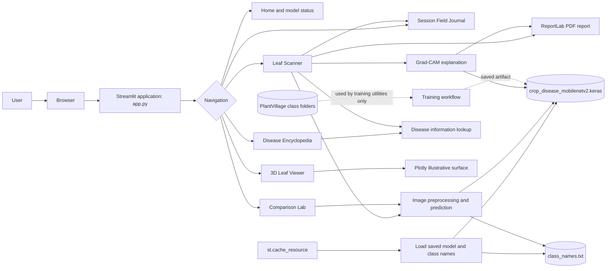
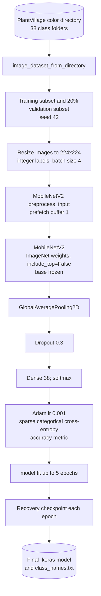
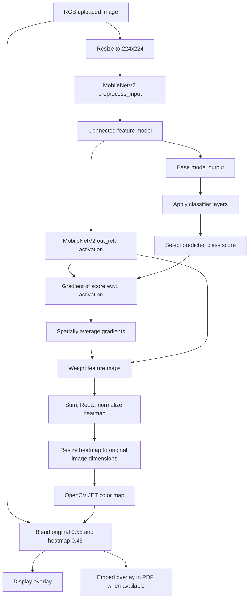

# BOTANICA Architecture Diagrams

These diagrams describe the inspected implementation. The training workflow
is separate from normal Streamlit startup and inference. Mermaid diagrams can
be rendered by compatible Markdown viewers.

## 1. Overall system architecture



## 2. Image upload and prediction workflow

```mermaid
sequenceDiagram
    actor User
    participant UI as Streamlit Leaf Scanner
    participant Decoder as PIL upload validation
    participant Cache as st.cache_resource
    participant Predict as src/predict.py
    participant Model as Saved MobileNetV2 model
    participant Info as Disease information
    participant Outputs as Grad-CAM / PDF / Field Journal

    User->>UI: Upload JPG/JPEG/PNG
    UI->>Decoder: Decode actual file content
    Decoder->>Decoder: Validate JPEG/PNG; convert RGB
    Decoder-->>UI: RGB image
    User->>UI: Run AI examination
    Cache-->>Predict: Reuse loaded model and class list
    Predict->>Predict: Resize to 224x224; array + batch dimension
    Predict->>Predict: Apply MobileNetV2 preprocess_input once
    Predict->>Model: Predict one image
    Model-->>Predict: 38 softmax scores
    Predict->>Predict: Argmax; confidence = selected score x 100
    Predict-->>UI: Class name, confidence, scores
    UI->>Info: Look up class description and guidance
    UI->>Outputs: Generate/cache explanation, report, and session record
    UI-->>User: Display prediction and available outputs
```

## 3. Model training workflow



The training script can resume from valid recovery checkpoints. Training is
not part of normal application startup and was not run during documentation
preparation. The code sets a validation split of 0.20; it does not explicitly
configure a stratified split.

## 4. Grad-CAM explanation workflow



In the application, the small heatmap is reused from session state for the
same uploaded-image hash. The full-resolution overlay is produced for
display/report use. Grad-CAM is an explanatory visualization, not proof of
disease presence or severity.
