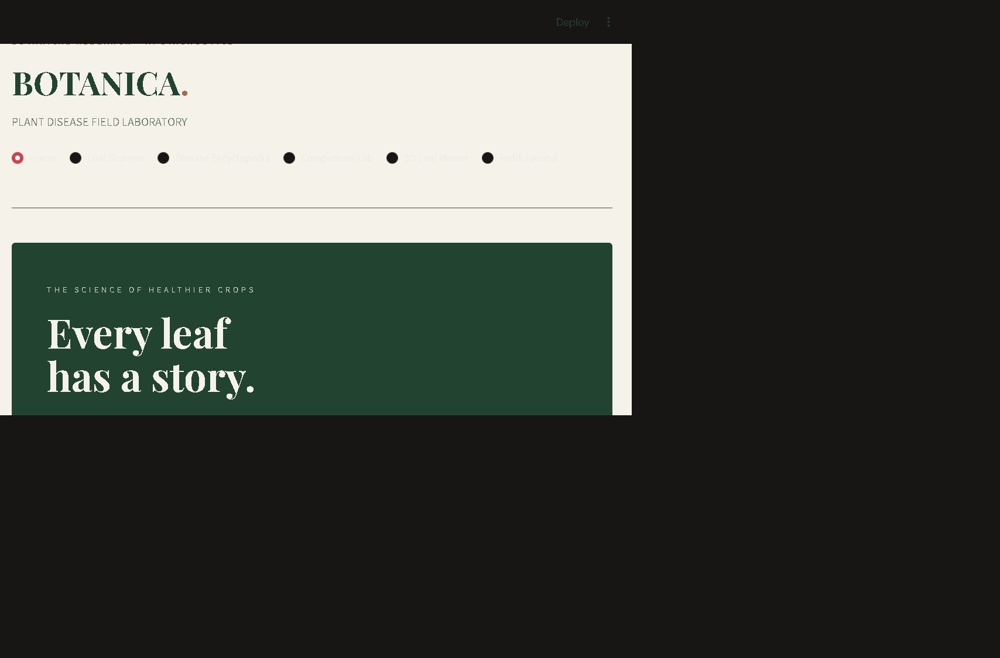
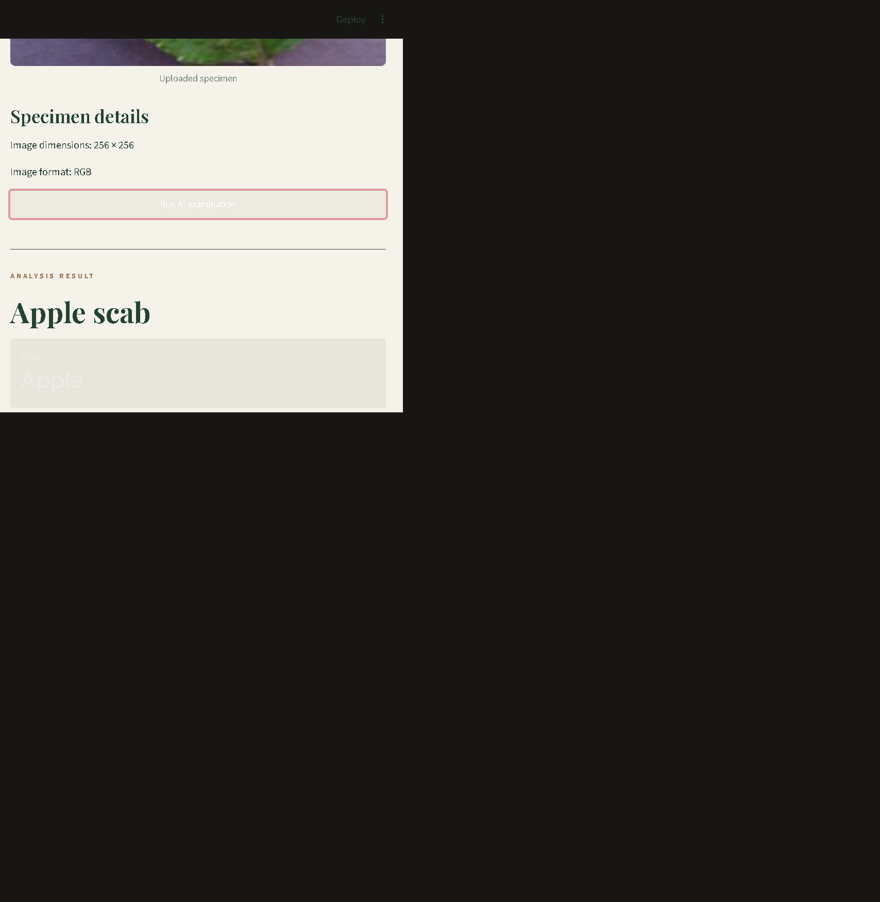
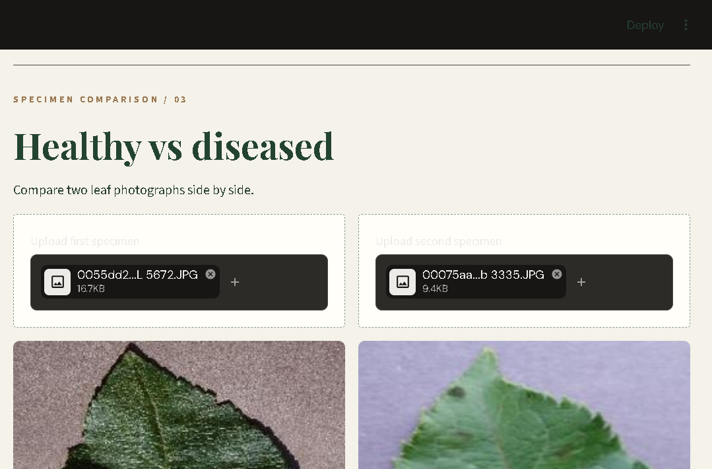
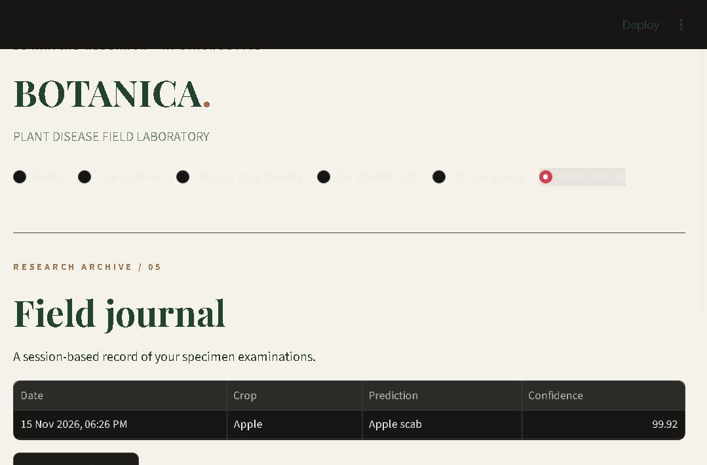
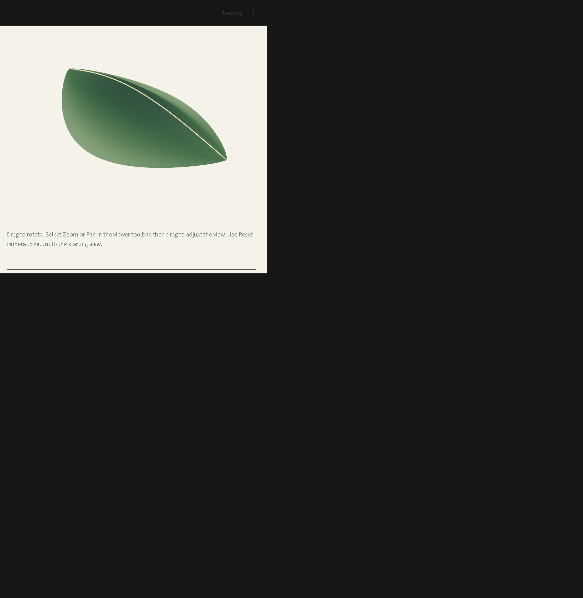
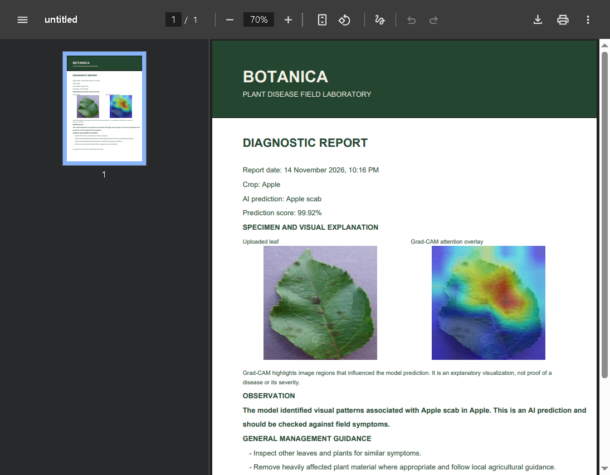

# BOTANICA: Crop Disease Detection Using Deep Learning

## Academic Project Report

**Degree:** B.Tech Minor Project  
**Student:** [Student name and roll number]  
**Department:** [Department]  
**Institution:** [Institution]  
**Project guide:** [Guide name]  
**Submission date:** [Submission date]

> **Evidence note.** This report describes the inspected project and its
> available records. The training metrics in Chapter 13 were supplied with
> the project and were not reproduced during this documentation work. The
> sample prediction scores are outputs for the exact PlantVillage images
> identified in the QA record, not evaluation metrics. BOTANICA is an
> educational prototype, not a validated agricultural diagnostic service.

## Abstract

BOTANICA is a Streamlit application for educational exploration of crop-leaf
image classification. It uses an existing MobileNetV2-based Keras model to
classify one uploaded image into one of 38 PlantVillage crop-condition
categories. The interface includes an image scanner, general disease
information, a Grad-CAM visualization, a PDF report workflow, a session-based
field journal, a two-image comparison feature, and an illustrative 3D leaf
viewer.

The local PlantVillage directory inventory contains 54,305 images in 38
non-empty class folders. The inspected training code configures a 20%
validation subset, 224 x 224 RGB images, MobileNetV2 preprocessing, and
transfer learning with a frozen ImageNet MobileNetV2 feature extractor. The
reported run used five epochs. Previously supplied results are 94.36%
training accuracy, 95.27% validation accuracy, 0.1970 training loss, and
0.1866 validation loss. These values are reported for completeness; they
were not independently reproduced for this report, and no separate test-set
results are available.

The application and selected features were exercised in a browser using
actual PlantVillage examples. This verifies application paths and example
outputs only. It does not establish accuracy on unseen or field-collected
images. A genuine previously saved diagnosis PDF was opened in the browser,
and a genuine viewer capture shows the 3D surface and controls.

**Keywords:** plant disease classification, MobileNetV2, transfer learning,
PlantVillage, Grad-CAM, Streamlit

## 1. Introduction

Plant-leaf image classification is a computer-vision task in which an image
is mapped to one of a set of crop and condition categories. Prior research
has explored deep convolutional networks using public plant-leaf datasets,
including the PlantVillage collection [1]. BOTANICA applies this general
approach in a small educational application: the user supplies a leaf image,
the saved classifier returns a category score vector, and the interface
shows the highest-scoring category.

The application is intended to make a previously trained model accessible
for a project demonstration. It is not designed to replace field inspection,
plant pathology expertise, or locally appropriate agricultural advice.

## 2. Problem Statement

The project addresses the implementation problem of presenting a trained
image classifier through an accessible interface. Given a supported JPEG or
PNG image, BOTANICA preprocesses the image and predicts one of the model's
38 saved class names. It then displays the selected class and its model
score.

This is a closed-set classification task: the model always selects among its
known labels, even if an uploaded image is unrelated, ambiguous, or unlike
the training data. The displayed score is the selected softmax output
expressed as a percentage. It is not a calibrated probability or a
guarantee that the named condition is present.

## 3. Objectives

1. Reuse the completed MobileNetV2 classifier without retraining it at
   application runtime.
2. Classify supported uploaded leaf images among the saved 38 categories.
3. Show general educational information for the selected category.
4. Provide a Grad-CAM visualization as an explanatory aid.
5. Support report generation, session-based record keeping, side-by-side
   specimen comparison, and an illustrative 3D viewer.
6. Preserve the existing BOTANICA interface, model, data, and checkpoints.

## 4. Existing System

Visual assessment by trained personnel and image-based classification are
different forms of plant-disease assessment. The literature describes
convolutional-network experiments on PlantVillage images [1]. Those
published experiments are contextual background, not a benchmark comparison
against BOTANICA. The project did not conduct a controlled comparison with
manual inspection or another classifier, so no relative performance claim
is made.

## 5. Proposed System

BOTANICA provides a browser interface around an already saved classifier.
The user selects a page, uploads a JPG/JPEG/PNG specimen in the scanner, and
runs an examination. The app displays the predicted category, score, a
general summary, and an available Grad-CAM overlay. It can prepare a PDF
diagnosis report and append the result to the current session's field
journal. Separate pages support browsing disease information, comparing two
images, and viewing an illustrative 3D leaf surface.

The comparison produces two independent predictions; it does not estimate
disease severity or progression. The 3D surface is a parametric illustration,
not a scan or reconstruction of the submitted image.

## 6. Literature Review

Hughes and Salathé introduced an open repository of plant-health images to
support mobile disease-diagnostic research [4]. Mohanty, Hughes, and Salathé
later reported a convolutional-network study using 54,306 PlantVillage
images across 38 crop-condition classes [1]. Their paper describes the
dataset as collected under controlled conditions and reports its own
experimental results. Those results belong to that publication and must not
be attributed to BOTANICA. Together, these works provide dataset and
research context; the curated image benchmark is not an independent
evaluation of this project's model.

MobileNetV2 introduces inverted residual blocks and linear bottlenecks for
an efficient convolutional architecture [2]. BOTANICA uses the
ImageNet-pretrained MobileNetV2 implementation as a frozen feature extractor
and adds a task-specific classification head. This follows the general
transfer-learning workflow described in the Keras guide [6]. Ferentinos
surveyed and evaluated deep-learning models for plant-disease detection and
diagnosis [5]. That work is relevant prior research, but its results are not
directly comparable with BOTANICA's supplied metrics because the models,
protocols, and experimental settings differ.

Grad-CAM uses gradients flowing into a convolutional feature layer to create
a coarse localization visualization for a selected model concept [3]. In
BOTANICA, this visualization is intended to show regions that influenced
the selected class score. It does not establish causal reasoning, disease
severity, or biological correctness.

The project's literature review is limited to primary research and official
framework documentation that could be verified for this submission. A
broader survey of field-deployment studies, agricultural management
recommendations, and dataset licensing remains outside the verified
evidence collected here.

## 7. Technology Stack

The previously verified project environment is Python 3.11.9, TensorFlow
2.21.0, and Streamlit 1.67.0. The source also uses NumPy, Pandas, Pillow,
OpenCV, Plotly, and ReportLab. The dependency list is in the project
`requirements.txt`; the report does not imply that every listed package is
used on every application path.

TensorFlow/Keras provides the image dataset utility, MobileNetV2 model,
preprocessing function, and model inference APIs [7-9]. Streamlit provides
the application widgets, resource caching, session interaction, and
download-button mechanism [10-12].

## 8. Dataset Description

The local dataset path used by the training code is
`dataset/raw/plantvillage dataset/color/`. The inspected directory contains
54,305 image files in 38 non-empty class directories. The project class
names match the sorted directory names in the inspected inventory. The
observed file extensions are 54,303 `.jpg`, one `.jpeg`, and one `.png`.

The PlantVillage paper reports 54,306 images and 38 class labels [1, 4]. The
one-image difference between that published count and the current local
inventory is recorded as observed; its cause was not established. The
published count and this project's local count should not be silently
substituted for each other.

The loader uses `image_dataset_from_directory`, integer labels, image size
224 x 224, batch size 4, `validation_split=0.20`, and seed 42 [8]. The
source does not explicitly configure stratification or data augmentation.
The 20% subset is a validation subset, not a separately documented test
set.

## 9. System Architecture

The four implementation-based diagrams are in
[architecture-diagrams.md](./architecture-diagrams.md). In summary,
`app.py` provides navigation and the user interface. The cached model loader
in `src/predict.py` reads the saved `.keras` model and class list. The
scanner and comparison page call the prediction function. The scanner can
also call `src/gradcam.py`, retrieve disease information from
`src/disease_info.py`, prepare a PDF with ReportLab, and update the
Streamlit-session journal.

The training scripts are separate from normal application startup. Opening
the application does not invoke the dataset loader or start training.
Streamlit's `st.cache_resource` is used for model and class loading, as
recommended for a shared machine-learning resource [10].

## 10. Methodology

The project has two distinct workflows:

1. **Training workflow:** the training utility loads class-folder images,
   creates training and validation subsets, preprocesses them, constructs
   and compiles the model, fits for the configured epochs, and saves model
   and recovery artifacts.
2. **Inference workflow:** the Streamlit app loads the saved model, validates
   the uploaded image, preprocesses it, requests one prediction, and maps the
   highest-scoring output index to the saved class-name order.

Training configuration is documented from `src/preprocessing.py` and
`src/train.py`; this report preparation did not run training. The model
architecture and preprocessing details below refer to inspected source and
saved-model metadata.

## 11. Image Preprocessing

Training images are loaded from class-named directories and resized to
224 x 224. The training data pipeline maps
`tf.keras.applications.mobilenet_v2.preprocess_input` over each batch.
TensorFlow documents this preprocessing function as scaling pixel values to
the range [-1, 1] [9].

At inference, the uploaded content is decoded, converted to RGB, resized to
224 x 224, converted to an array, given a batch dimension, and passed through
MobileNetV2 preprocessing once before prediction. The returned model output
is checked against the number of saved class names; the maximum score index
selects the predicted class.

## 12. MobileNetV2 Model Architecture

The training code constructs `MobileNetV2` with ImageNet weights and
`include_top=False`, then marks the base model non-trainable [2, 7]. The
task-specific head is:

1. GlobalAveragePooling2D
2. Dropout with rate 0.3
3. Dense output with 38 units and softmax activation

The inspected saved model has input shape `[None, 224, 224, 3]`, a
MobileNetV2 base named `mobilenetv2_1.00_224`, and 38 output scores. The
compiled training configuration uses Adam with learning rate 0.001 and
sparse categorical cross-entropy.

## 13. Model Training and Evaluation

The inspected training configuration specifies five epochs, batch size 4,
an 80/20 training-validation split with seed 42, Adam at 0.001, sparse
categorical cross-entropy, and accuracy as a metric. The source supports
recovery from epoch checkpoints. The saved model and five recovery
checkpoints were preserved; no training was launched for this report.

The following values were supplied as results of the completed project run:

| Metric | Previously reported value |
| --- | ---: |
| Training accuracy | 94.36% |
| Validation accuracy | 95.27% |
| Training loss | 0.1970 |
| Validation loss | 0.1866 |

These are **previously reported project results, not independently
reproduced results**. No training log was available for independent
verification. Validation accuracy is not test accuracy. No precision,
recall, F1, confusion matrix, calibration, or independent test-set metric
is claimed.

During browser QA, a specific Apple scab PlantVillage example produced
99.92%, and a specific Apple healthy comparison example produced 100.00%.
These are predictions for those two inputs only. They are not test-set
results or measures of model accuracy.

## 14. Grad-CAM Explainability

The implementation finds the nested MobileNetV2 model and uses its
`out_relu` activation. It computes the gradient of the predicted-class score
with respect to that activation, averages the gradients spatially, weights
the feature maps, sums them, applies ReLU, and normalizes the resulting
heatmap. The app resizes the heatmap to the uploaded image dimensions,
applies OpenCV's JET color map, and blends the heatmap with the original
image using weights 0.45 and 0.55 respectively.

The resulting overlay is a visualization of image regions associated with
the model score, following the general Grad-CAM idea [3]. It is not proof of
the crop condition, a causal explanation, or a measure of disease extent.

## 15. Application Design and Implementation

The existing Streamlit interface retains six navigation sections: Home,
Leaf Scanner, Disease Encyclopedia, Comparison Lab, 3D Leaf Viewer, and Field
Journal. The model loader is cached with `st.cache_resource`; the scanner
stores its latest result and reuses a Grad-CAM heatmap for the same uploaded
image within the session. The journal is stored in Streamlit session state
and is not persistent across sessions.

The PDF helper produces a BOTANICA-branded report with a generation date and
time, prediction and score, disease information, uploaded image, and the
Grad-CAM overlay/explanation when available. The interface configures the
download name as `botanica_diagnostic_report.pdf` with MIME type
`application/pdf`. A genuine existing PDF generated by the project was
opened in the browser and is included as
[botanica-diagnostic-report-example.pdf](./botanica-diagnostic-report-example.pdf).
The download button was not re-triggered in this documentation audit; its
configuration is verified in source, and the existing PDF content was
visually inspected.

The 3D viewer constructs an illustrative parametric surface and central
vein. It is not derived from the uploaded specimen. During final review, the
live viewer rendered the surface and exposed Plotly zoom, pan, rotation,
reset, and fullscreen controls. The saved captures show the surface but do
not clearly show the toolbar; this live check does not establish exhaustive
interaction testing of every control.

## 16. Testing and Results

### Application checks performed for this package

- Started the existing app using the project's `.venv` Python executable.
- Confirmed `http://127.0.0.1:8501/` and `/_stcore/health` returned HTTP 200.
- Confirmed the Home page showed the model-loaded status and 38 recognized
  categories.
- Uploaded an existing Apple scab PlantVillage JPEG. The page displayed
  256 x 256 dimensions and RGB format; prediction output was Apple scab at
  99.92%. A Grad-CAM overlay and disease guidance appeared.
- Compared existing Apple healthy and Apple scab images. The displayed
  scores were 100.00% and 99.92% for those examples.
- Opened the Disease Encyclopedia and confirmed its Apple scab information.
- Ran the scanner and confirmed a row appeared in the session Field Journal.
- Confirmed the 3D page exposed Plotly zoom, pan, rotation, reset, and
  fullscreen controls; an unaltered capture shows the rendered parametric
  leaf.
- Opened a genuine existing BOTANICA diagnostic PDF in the browser. The
  report shows BOTANICA branding, report date/time, Apple scab, 99.92% sample
  score, specimen image, Grad-CAM overlay, observation, and guidance. The
  actual download button was not triggered during this audit.

These are application-level checks on selected inputs, not an independent
scientific evaluation. They do not measure performance on new images or
field conditions. Authentic captures that show current browser output are
listed in [screenshots/](./screenshots/) and the
[screenshot checklist](./screenshot-checklist.md).

## 17. Limitations

1. No independently reproduced training log or separate test-set results
   are available in the evidence reviewed for this report.
2. The supplied validation metrics do not establish performance on
   field-collected images, other cameras, lighting, backgrounds, varieties,
   or symptom stages.
3. The 38-way classifier is closed-set and may return a class for unsuitable
   or out-of-domain images.
4. The displayed softmax score is not calibrated.
5. General disease information is educational and is not a treatment
   prescription.
6. Grad-CAM is an explanatory visualization, not proof of a diagnosis.
7. Journal records last only for the current Streamlit session.
8. The 3D leaf is illustrative, not specimen-derived.
9. The PDF download button was not re-triggered during this documentation
   audit, although a genuine saved report was opened and inspected.
10. The local image inventory count (54,305) differs by one from the
    PlantVillage count reported in the cited paper (54,306); the reason was
    not determined.
11. Dataset provenance and license/redistribution terms should be confirmed
    from the actual dataset source before redistribution or final submission.

## 18. Future Scope

- Evaluate the saved model on a documented, independent set of field images.
- Preserve a clear separation between training, validation, and final test
  sets, and document the sampling process.
- Report per-class precision, recall, F1, confusion matrices, and confidence
  calibration only after running a reproducible evaluation.
- Review disease information with qualified agricultural experts and cite
  local authoritative guidance.
- Investigate robustness to image quality and distribution shift without
  implying that performance is established in advance.
- Consider optional persistent journal storage with explicit user consent.
- Re-test the Plotly surface and PDF download in a normal desktop browser.

## 19. Conclusion

BOTANICA packages an existing MobileNetV2 crop-condition classifier in a
Streamlit educational application. Inspection confirmed a 38-output model,
224 x 224 RGB inference input, a frozen ImageNet MobileNetV2 base, and the
specified pooling, dropout, and softmax head. Selected end-to-end browser
checks produced predictions, Grad-CAM output, disease information,
comparison results, and a field-journal entry.

The supplied five-epoch metrics are recorded as previously reported and
were not reproduced for this report. The observed example predictions do
not establish general accuracy. The report includes a genuine previously
saved diagnostic PDF and a genuine screenshot of the rendered 3D surface.
Within these limits, the project demonstrates an educational
image-classification workflow without changing its trained assets or
application design.

## 20. References

1. **Mohanty, Sharada P.; David P. Hughes; and Marcel Salathé.** “Using
   Deep Learning for Image-Based Plant Disease Detection.” *Frontiers in
   Plant Science*, vol. 7, article 1419, 2016.
   https://doi.org/10.3389/fpls.2016.01419  
   Supports the PlantVillage dataset context and prior plant-disease image
   classification research. The paper reports 54,306 images and 38 classes;
   its results are not BOTANICA results.
2. **Sandler, Mark; Andrew Howard; Menglong Zhu; Andrey Zhmoginov; and
   Liang-Chieh Chen.** “MobileNetV2: Inverted Residuals and Linear
   Bottlenecks.” *2018 IEEE/CVF Conference on Computer Vision and Pattern
   Recognition (CVPR)*, pp. 4510-4520, 2018.
   https://doi.org/10.1109/CVPR.2018.00474  
   Original MobileNetV2 architecture paper.
3. **Selvaraju, Ramprasaath R.; Michael Cogswell; Abhishek Das; Ramakrishna
   Vedantam; Devi Parikh; and Dhruv Batra.** “Grad-CAM: Visual Explanations
   from Deep Networks via Gradient-Based Localization.” *Proceedings of the
   IEEE International Conference on Computer Vision (ICCV)*, pp. 618-626,
   2017. https://doi.org/10.1109/ICCV.2017.74  
   Original Grad-CAM paper.
4. **Hughes, David P.; and Marcel Salathé.** “An open access repository of
   images on plant health to enable the development of mobile disease
   diagnostics.” arXiv:1511.08060, 2015.
   https://doi.org/10.48550/arXiv.1511.08060  
   PlantVillage image repository and motivation; a preprint/repository
   record, not a journal publication.
5. **Ferentinos, Konstantinos P.** “Deep learning models for plant disease
   detection and diagnosis.” *Computers and Electronics in Agriculture*,
   vol. 145, pp. 311-318, 2018.
   https://doi.org/10.1016/j.compag.2018.01.009  
   Related plant-disease deep-learning research. Its evaluation is not
   directly comparable to BOTANICA's project-supplied metrics.
6. **Chollet, François / Keras.** “Transfer learning & fine-tuning.”
   TensorFlow/Keras guide, undated living documentation.
   https://www.tensorflow.org/guide/keras/transfer_learning
   (accessed 19 November 2026).  
   Supports the general frozen-pretrained-base and task-head workflow.
7. **TensorFlow Authors.** “tf.keras.applications.MobileNetV2.”
   TensorFlow API documentation.
   https://www.tensorflow.org/api_docs/python/tf/keras/applications/MobileNetV2
   (accessed 19 November 2026).  
   Official API documentation for the architecture used.
8. **TensorFlow Authors.** “tf.keras.utils.image_dataset_from_directory.”
   TensorFlow API documentation.
   https://www.tensorflow.org/api_docs/python/tf/keras/utils/image_dataset_from_directory
   (accessed 19 November 2026).  
   Official API documentation for folder-based dataset loading and split
   parameters.
9. **TensorFlow Authors.**
   “tf.keras.applications.mobilenet_v2.preprocess_input.” TensorFlow API
   documentation.
   https://www.tensorflow.org/api_docs/python/tf/keras/applications/mobilenet_v2/preprocess_input
   (accessed 19 November 2026).  
   Official documentation for MobileNetV2 input preprocessing.
10. **Streamlit.** “st.cache_resource.” Streamlit API documentation.
    https://docs.streamlit.io/develop/api-reference/caching-and-state/st.cache_resource
    (accessed 19 November 2026).  
    Official documentation for caching resource objects such as ML models.
11. **Streamlit.** “Caching overview.” Streamlit documentation.
    https://docs.streamlit.io/develop/concepts/architecture/caching
    (accessed 19 November 2026).  
    Supports the distinction between cached data and shared resources.
12. **Streamlit.** “st.file_uploader” and “st.download_button.” Streamlit API
    documentation.
    https://docs.streamlit.io/develop/api-reference/widgets/st.file_uploader
    and
    https://docs.streamlit.io/develop/api-reference/widgets/st.download_button
    (accessed 19 November 2026).  
    Official documentation for the upload and download widgets.

### Selected genuine browser captures

These are unaltered captures of the local application and example outputs.
They document application behavior, not evaluation performance.

**Home page**

**Scanner result and Grad-CAM**

**Comparison Lab**

**Field Journal**

**3D Leaf Viewer**

**Existing diagnosis report**

The diagnosis PDF itself is included as
[botanica-diagnostic-report-example.pdf](./botanica-diagnostic-report-example.pdf).
The file was opened and visually inspected. The download button was not
re-triggered in this documentation audit; see
[screenshot-checklist.md](./screenshot-checklist.md) for precise evidence
boundaries.

### Bibliographic verification record

The Frontiers article page was checked for author names, title, journal,
date, DOI, and the published dataset description. The CVF ICCV 2017 Open
Access page was checked for the Grad-CAM title, author order, proceedings,
and page range; its DOI record was cross-checked in OpenAlex metadata. The
MobileNetV2 title, authors, year, venue, pages, and DOI were cross-checked
against OpenAlex bibliographic metadata, the DOI record, and the TensorFlow
MobileNetV2 documentation reference to the original paper. Ferentinos'
article title, author, journal, volume, pages, year, and DOI were checked in
OpenAlex metadata. Hughes and Salathé's preprint title, authors, year, and
DOI were likewise checked in OpenAlex metadata. TensorFlow and Streamlit
API details were checked against their official documentation pages.
Sources were checked for this audit on 19 November 2026.
